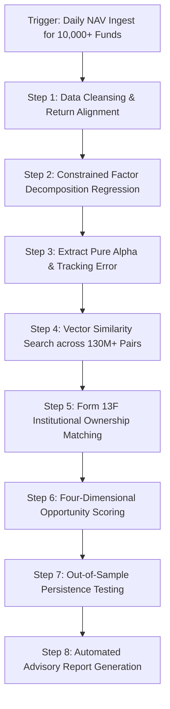

# 📊 PortfolioFuture: Quantitative Analyst — Real-World Job Mastery Blueprint

**Target Role**: Quantitative Analyst (Fund Discovery, Portfolio Analytics & Asset-Manager Distribution Intelligence)  
**Organization**: PortfolioFuture — New York, NY (Remote)  
**Scope**: 10,000+ Funds, 130M+ Fund Relationships, 290M+ Ownership Opportunities, 20,000+ RIAs, 400,000+ Financial Advisors  
**Core Technical Pillars**: Quantitative Finance, Econometric Decomposition, Machine Learning, SEC Filings (13F/ADV), Large-Scale Optimization  
**Candidate**: Bhupesh Chandra | Chief Learning Officer Mastery Architecture  

---

## 🧭 1. ROLE INPUTS & OPERATIONAL CONTEXT

| Dimension | Specification |
|---|---|
| **Company Profile** | Independent fund discovery and intelligence company. Connects over 10,000 ETFs and mutual funds with institutional allocators and financial advisory firms through empirical, unconflicted research. |
| **Core Intellectual Property** | 1. **Fund Substitution**: Identifying ETFs/funds that can serve similar portfolio roles using return similarity, relative performance, tracking error, and fees.<br/>2. **Fund Decomposition**: Separating investable market/factor exposures from pure residual alpha ($\alpha$) and risk ($\sigma_\epsilon$).<br/>3. **Fund Opportunity**: Multi-dimensional ranking across Similar Fund Ranking, Addressable Market, Pure Alpha, and Diversification Benefits. |
| **Primary Directive** | Absolute research independence. Commercial relationships do NOT affect which funds surface, how they rank, or research conclusions. |
| **Primary Datasets** | Daily Adjusted NAV returns, SEC Form 13F (Institutional Equity Holdings), Form ADV/IAPD (RIA AUM and Asset Allocation), SEC Form N-PORT (Monthly portfolio investments). |
| **Tech Stack** | Python (NumPy, SciPy, Pandas, Polars, Statsmodels, CVXPY), PyTorch/Scikit-Learn, DuckDB/PostgreSQL, LLM prompt engineering, Quantum optimization (QAOA/QUBO exploration). |

---

## 🗺️ PHASE 1: THE JOB INTELLIGENCE MAP

```
┌────────────────────────────────────────────────────────────────────────┐
│                     PORTFOLIOFUTURE QUANT ENGINE                       │
├────────────────────────────────────────────────────────────────────────┤
│ TIER 1: CRITICAL (Directly drives core IP, client models, and ranking) │
│  • Task 1: Investable Return Decomposition (Factor Alpha vs. Beta)    │
│  • Task 2: Pairwise Fund Substitution & Similarity Modeling            │
│  • Task 3: SEC Form 13F & Form ADV Ownership Intelligence Mapping     │
├────────────────────────────────────────────────────────────────────────┤
│ TIER 2: SUPPORTING (Drives portfolio tools & advanced features)        │
│  • Task 4: Large-Scale Portfolio Construction & Optimization (CVXPY)   │
│  • Task 5: LLM-Driven Unstructured SEC Document Information Extraction │
│  • Task 6: Quantum Optimization Explorations (QUBO Formulation)        │
└────────────────────────────────────────────────────────────────────────┘
```

### Responsibility 1: Investable Return Decomposition (TIER 1 — CRITICAL)
1. **Plain English**: Peeling back the layers of a fund's returns to prove whether outperformance is genuine managerial skill ("pure alpha") or simply expensive, commoditized factor beta (e.g., leveraged exposure to large-cap momentum or tech).
2. **Business Purpose**: Enables RIAs to avoid paying 75+ bps active management fees for returns that could be replicated using a 7 bps passive ETF mix.
3. **Trigger & Frequency**: Daily upon NAV ingest; monthly full-universe recalculation.
4. **Inputs & Systems**: Adjusted daily returns, benchmark factor returns (Fama-French 5-factor, Carhart, liquid ETF replication proxies), CRSP/Morningstar feeds.
5. **Exact Steps**:
   - Run constrained rolling regression: $R_{F,t} - R_{f,t} = \alpha_F + \sum_{k=1}^K \beta_k (R_{k,t} - R_{f,t}) + \epsilon_{F,t}$.
   - Enforce long-only and budget constraints: $\beta_k \ge 0$, $\sum \beta_k \le 1$.
   - Calculate residual risk $\sigma(\epsilon)$ and Information Ratio: $IR = \frac{\alpha_F}{\sigma(\epsilon)}$.
   - Deduct net expense ratio delta to isolate **Pure Investable Alpha**.
6. **Output & Definition of Done**: Decomposition vector ($\alpha$, $\{\beta_k\}$, $R^2$, Tracking Error) stored in database for every fund with verified statistical significance ($t\text{-stat} > 2.0$, $p < 0.05$).
7. **Quality Standards**: Zero lookahead bias; $R^2 > 0.85$ for core replication baskets.

---

### Responsibility 2: Pairwise Fund Substitution & Ranking Engine (TIER 1 — CRITICAL)
1. **Plain English**: Finding cheaper, higher-performing, or more liquid ETFs that can replace an existing mutual fund or ETF in an advisor's model portfolio without disrupting their asset allocation.
2. **Business Purpose**: The core client-facing recommendation engine for financial advisors looking to optimize client portfolios and tax-loss harvesting candidates.
3. **Trigger & Frequency**: Real-time advisor portfolio scans and daily batch matrix updates across 10,000+ funds.
4. **Inputs & Systems**: Daily return time-series, historical correlation matrices, expense ratio databases, bid-ask spreads, asset class taxonomies.
5. **Exact Steps**:
   - Filter universe by asset class and liquidity threshold ($AUM > \$50M$, ADV > $1M).
   - Compute multi-horizon return similarity (Cosine Similarity on 1-yr, 3-yr, 5-yr daily returns).
   - Evaluate tracking error between Target Fund $A$ and Candidate Substitute $B$.
   - Rank candidates across the 4 Opportunity Dimensions: Similar Fund Ranking, Addressable Market, Pure Alpha, and Diversification Benefits.
6. **Output & Definition of Done**: Ranked substitution shortlist with explicit fee savings ($bps$) and residual alpha gain.
7. **Quality Standards**: Candidate tracking error $< 2.50\%$ annualized; fee reduction $> 15$ bps.

---

### Responsibility 3: SEC Form 13F & Form ADV Ownership Intelligence (TIER 1 — CRITICAL)
1. **Plain English**: Analyzing mandatory quarterly regulatory filings to map out which institutional wealth managers and RIAs hold inferior, high-fee funds across the 290M+ ownership opportunities.
2. **Business Purpose**: Powers distribution intelligence for asset managers, showing them exactly which advisors hold competing high-fee funds and have capital ripe for displacement.
3. **Trigger & Frequency**: Quarterly SEC 13F filing deadlines (45 days post-quarter-end) and monthly Form ADV updates.
4. **Inputs & Systems**: SEC EDGAR XML/JSON feeds, Form 13F-HR schedules, Form ADV Part 1A/2A brochures, CRD database.
5. **Exact Steps**:
   - Ingest raw 13F CUSIP tables and parse holdings.
   - Clean and reconcile CUSIP-to-ticker mapping tables.
   - Cross-reference RIA AUM disclosures from Form ADV Schedule D.
   - Compute addressable switching market for each target fund: $\sum_{i \in RIAs} \text{Position Size}_{i}$.
6. **Output & Definition of Done**: Fund Distribution Opportunity Matrix linking every ETF to specific RIA capital pools with verified contact intelligence.
7. **Quality Standards**: 100% reconciliation of CUSIP mapping; accurate flagging of 45-day reporting lag.

---

## ⚙️ PHASE 2: REVERSE-ENGINEERED WORKFLOW — FUND SUBSTITUTION & DECOMPOSITION



---

## 💻 PHASE 3: PROGRESSIVE QUANTITATIVE SKILL CURRICULUM

### Level 1: Foundations
- **Cosine Return Similarity**:
  $$\text{Cosine Similarity}(\mathbf{r}_A, \mathbf{r}_B) = \frac{\mathbf{r}_A \cdot \mathbf{r}_B}{\|\mathbf{r}_A\| \|\mathbf{r}_B\|}$$
- **Tracking Error (Annualized)**:
  $$\text{TE} = \sqrt{252} \times \sqrt{\frac{1}{N-1} \sum_{t=1}^N (R_{A,t} - R_{B,t} - \overline{\Delta R})^2}$$

### Level 2: Worked Example — Active Large-Cap Fund Decomposition
**Target Fund**: *Legacy Growth Fund (LGF)* — Net Expense Ratio: **0.85%** (85 bps)  
**Proposed Substitute**: *Active Core ETF (ACE)* — Net Expense Ratio: **0.25%** (25 bps)

1. **Multi-Factor Decomposition of LGF ($R^2 = 0.92$)**:
   - Market ($\beta_{MKT}$): 1.05
   - Size ($\beta_{SMB}$): -0.22 (Large-Cap tilt)
   - Value ($\beta_{HML}$): -0.35 (Growth tilt)
   - Gross Annualized Alpha ($\alpha_{gross}$): **+1.20%**
   - **Net Pure Alpha** after 0.85% expense ratio: $1.20\% - 0.85\% = \mathbf{+0.35\%}$
2. **Decomposition of Proposed Substitute ACE ($R^2 = 0.94$)**:
   - Market: 1.04, Size: -0.20, Value: -0.32
   - Gross Alpha: **+1.10%**
   - **Net Pure Alpha** after 0.25% expense ratio: $1.10\% - 0.25\% = \mathbf{+0.85\%}$
3. **The Substitution Arbitrage**:
   - **Fee Savings**: $85\text{ bps} - 25\text{ bps} = \mathbf{60\text{ bps}}$ ($6,000/yr per $1M invested).
   - **Net Alpha Improvement**: $+0.85\% - (+0.35\%) = \mathbf{+0.50\% / yr}$.
   - **Cosine Return Similarity**: **0.978** (97.8% co-movement).
   - **13F Addressable Market**: Form 13F shows 142 RIAs hold **$4.2 Billion** in LGF. Total annual fee savings addressable: **$25.2 Million**.

---

## 🧪 PHASE 4: PRACTICAL JOB SIMULATOR

### Scenario:
A registered investment advisory (RIA) firm managing $850M holds an expensive active global bond mutual fund: **Global Income Trust (GITX)** with a **0.95% expense ratio**.  
The RIA wants an ETF substitution recommendation that:
1. Maintains an annualized return similarity $\ge 0.95$.
2. Reduces total fee drag by at least 50 bps.
3. Provides an annualized Tracking Error $\le 2.0\%$.
4. Decomposes interest rate duration vs. credit spread beta.

---

## 🛠️ PHASE 6: PERSONAL WORK TOOLKIT

### Daily & Monthly Quant Cadence
- **08:30–09:30**: Automated NAV pipeline sanity checks (detect missing pricing feeds or stale splits).
- **09:30–12:30**: Factor regression calibrations and portfolio optimization research.
- **13:30–16:00**: SEC 13F and Form ADV relationship database ETL & graph analytics.
- **16:00–17:30**: Out-of-sample backtesting, persistence tests, and research documentation.

---

## 📅 PHASE 7: 30 / 60 / 90-DAY PROGRESSIVE PERFORMANCE ROADMAP

- **Days 1–30 (Pipeline Mastery & Decomposition Precision)**: Master internal DuckDB/SQL data schemas; reproduce baseline factor decomposition regressions with 100% statistical parity; automate daily SEC 13F CUSIP reconciliation pipelines.
- **Days 31–60 (Substitution Modeling & Out-of-Sample Robustness)**: Enhance the pairwise fund substitution matrix with multi-horizon tracking error algorithms; build automated 13F addressable market aggregators.
- **Days 61–90 (Optimization, Machine Learning & LLM Integration)**: Implement CVXPY-based portfolio construction engines; build LLM pipelines to extract fee tables from SEC Form N-PORT filings; publish an empirical research note on ETF factor replication quality.
